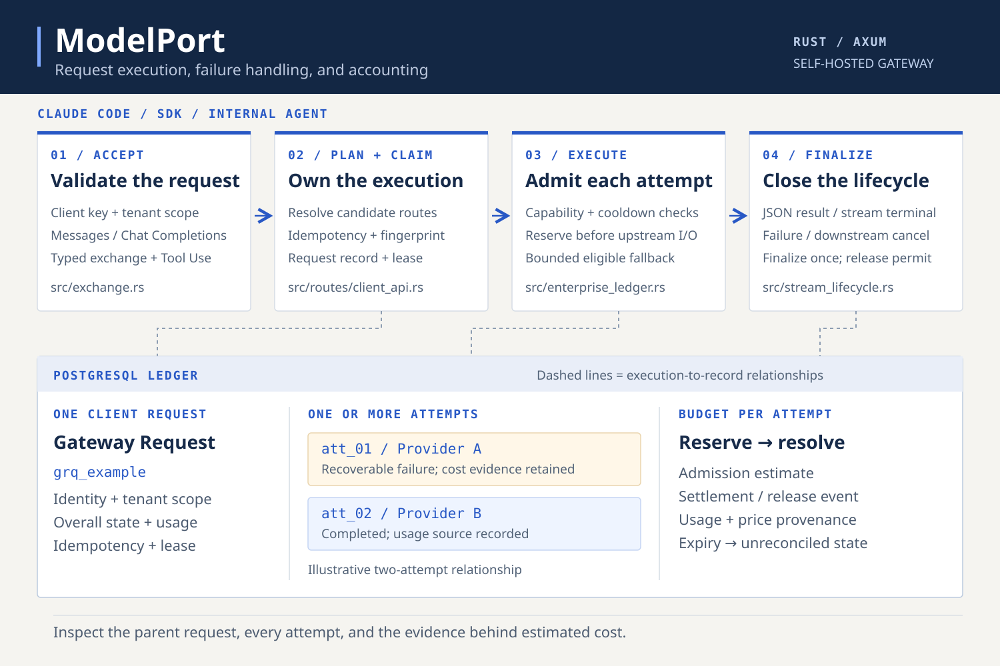
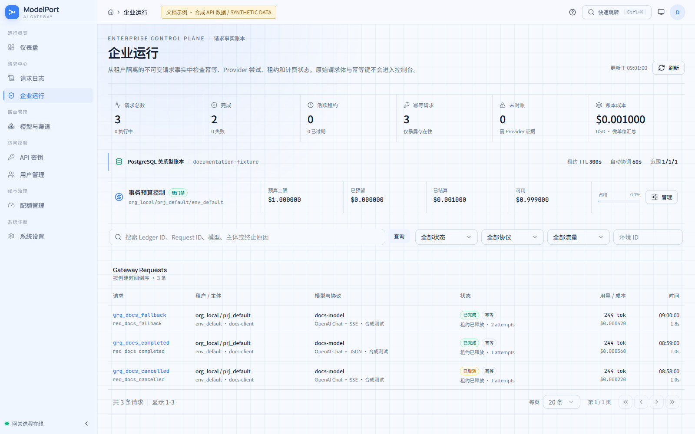
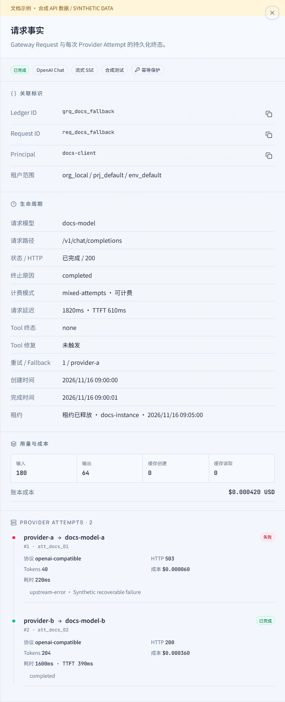

# ModelPort

**One model request. Every attempt accounted for.**

[](https://github.com/AoHanBei/ModelPort/actions/workflows/ci.yml) [](https://github.com/AoHanBei/ModelPort/actions/workflows/codeql.yml) [](LICENSE)

**English** | [简体中文](README.zh-CN.md)

ModelPort is a self-hosted LLM gateway built with Rust and Axum. It connects
Anthropic Messages and OpenAI Chat Completions clients to configured model
Providers through one entry point.

The core follows a request from protocol validation to routing, idempotency,
budget admission, upstream execution, and stream finalization. A PostgreSQL
ledger separates the client request from each Provider attempt, so retries,
failures, usage sources, and estimated costs remain inspectable.

[Quick start](#run-locally) · [Request lifecycle](docs/REQUEST_LIFECYCLE.md) · [Dashboard](#inspect-a-request) · [Documentation](docs/README.md)



## Five mechanisms behind a request

| Mechanism | What it handles | Implementation |
| --- | --- | --- |
| Protocol adaptation | Typed request/response exchange, Tool Use, and protocol-native streaming; rejects unsupported semantics. | [Exchange](src/exchange.rs), [Provider adapters](src/providers/) |
| Routing and fallback | Model resolution, credential and Provider cooldowns, and bounded candidate attempts under access, capability, and budget checks. | [Client request path](src/routes/client_api.rs), [Provider health](src/provider_status.rs) |
| Concurrent idempotency | Tenant-scoped key hashes, request fingerprints, database uniqueness, and renewable execution leases. Duplicate keyed requests return a conflict. | [Ledger](src/enterprise_ledger.rs), [Schema](migrations/0002_idempotency_and_leases.sql) |
| Budget accounting | A separate reservation for each admitted attempt, followed by settlement or reconciliation. Network I/O runs outside the database transaction. | [Transactional ledger](src/enterprise_ledger.rs) |
| Stream finalization | Distinguishes protocol completion, upstream failure, and downstream cancellation; converges normal and dropped-body paths on one finalization context. | [Stream lifecycle](src/stream_lifecycle.rs), [Finalization guard](src/routes/client_api.rs) |

For a worked failure scenario, representative tests, and the scope of each
guarantee, read [Request lifecycle](docs/REQUEST_LIFECYCLE.md).

## Inspect a request

The React dashboard exposes request state, tenant scope, idempotency presence,
lease status, Provider attempts, usage, and cost provenance. Open **Enterprise
operations (企业运行)** to move from a parent request to its individual attempts.



*Actual dashboard UI rendered with synthetic API fixtures for documentation.
The values illustrate the interface; they are not production measurements.*

<details>
<summary>Request detail and Provider attempts</summary>



*The detail view uses the same synthetic fixture. Screenshot provenance and
reproduction instructions are in [Assets](docs/assets/README.md).*

</details>

## Run locally

Use a trusted host or small private network. The Compose stack runs the gateway,
dashboard, and PostgreSQL. The commands below use a Bash shell on Linux or WSL,
Git, Docker, Docker Compose v2, and a Provider API key.

```bash
git clone https://github.com/AoHanBei/ModelPort.git
cd ModelPort
cp deploy/docker/modelport.env.example .env
cp config.example.toml config.toml
```

Replace every required `replace-with-...` value in `.env`: router token,
administrator credentials, PostgreSQL password, and Provider key. For the first
local request, keep `ANTHROPIC_AUTH_TOKEN` equal to `MODELPORT_AUTH_TOKEN`.

```bash
scripts/build-container.sh
docker compose up -d
docker compose ps
scripts/smoke-test.sh
```

Open `http://127.0.0.1:33002` and log in using
`MODELPORT_ADMIN_USERNAME` / `MODELPORT_ADMIN_PASSWORD`.

The default example uses `deepseek-v4-flash`. If your Provider exposes another
model ID, update the environment, model configuration, and request together.
The [Getting Started guide](docs/GETTING_STARTED.md) covers configuration,
startup failures, alternate Providers, and the first request.

### Connect a client

| Client | Base URL | Client credential |
| --- | --- | --- |
| Claude Code / Anthropic-compatible SDK | `http://127.0.0.1:38082` | `ANTHROPIC_AUTH_TOKEN` |
| OpenAI-compatible SDK | `http://127.0.0.1:38082/v1` | `OPENAI_API_KEY` |

Use the router token for the first local test and a dashboard-issued scoped
client key for shared use. Upstream Provider keys stay on the server.

```bash
source .env
curl -fsS http://127.0.0.1:38082/v1/messages \
  -H "x-api-key: $MODELPORT_AUTH_TOKEN" \
  -H 'content-type: application/json' \
  -d '{"model":"deepseek-v4-flash","max_tokens":96,"messages":[{"role":"user","content":"Reply exactly: OK"}]}'
```

This request can consume Provider quota. The ordinary smoke test checks local
health, readiness, and the model catalog; `scripts/smoke-test.sh --upstream`
explicitly makes an upstream request.

## Explore the implementation

| Task | Read next |
| --- | --- |
| Follow request execution and failure handling | [Request lifecycle and evidence](docs/REQUEST_LIFECYCLE.md) |
| Configure client APIs and Providers | [API](docs/API.md), [Configuration](docs/CONFIGURATION.md), [Providers](docs/PROVIDERS.md) |
| Explore optional smart routing or CPA channels | [Smart routing](docs/SMART_ROUTING.md), [CPA boundary](docs/adr/0004-modelport-gateway-and-cpa-provider-boundary.md) |
| Deploy, observe, back up, or restore | [Deployment](docs/DEPLOYMENT.md), [Operations](docs/OPERATIONS.md), [Production](docs/PRODUCTION.md) |
| Develop or review a change | [Development](docs/DEVELOPMENT.md), [Contributing](CONTRIBUTING.md) |

Before submitting code, run `scripts/check-all.sh` with the prerequisites in
the development guide. The [documentation index](docs/README.md) covers the
remaining guides and architecture decisions.

## Operating scope

The supported deployment boundary is one trusted host or a small trusted
network, with private backend/database ports and same-origin HTTPS for shared
use. Idempotency currently rejects duplicates rather than replaying responses.
Usage and cost records carry evidence sources and estimates; Provider invoices
remain the authority for actual charges. See [Security](SECURITY.md),
[Privacy](PRIVACY.md), [Support](SUPPORT.md), and [Roadmap](docs/ROADMAP.md).

## Project background

This public project is maintained by [AoHanBei](https://github.com/AoHanBei)
and was rebuilt from experience with an internal internship gateway.
[Project background](docs/PROJECT_BACKGROUND.md) records the contribution
boundaries and AI-assisted development.

Licensed under [MIT](LICENSE).
