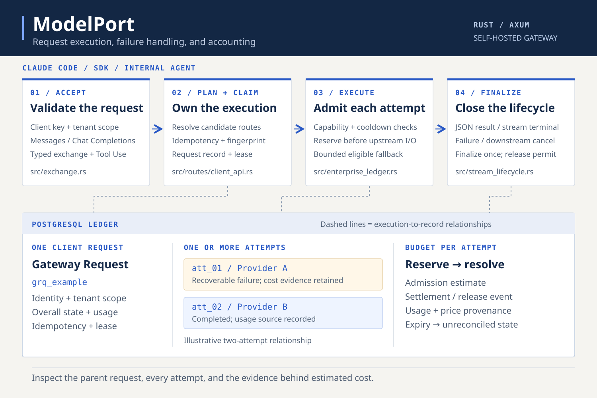
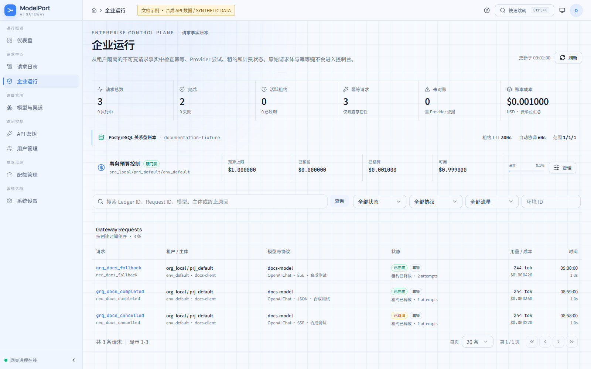
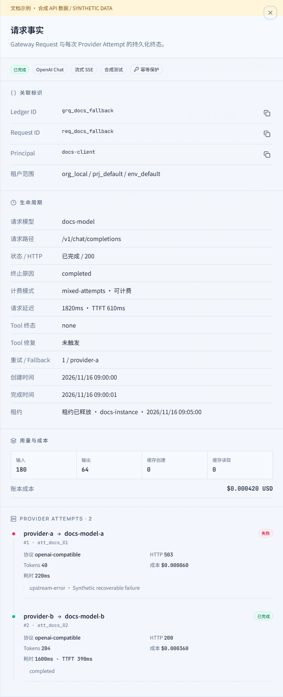

# ModelPort

**从一次模型请求，到每次上游尝试的执行与记账。**

[](https://github.com/AoHanBei/ModelPort/actions/workflows/ci.yml) [](https://github.com/AoHanBei/ModelPort/actions/workflows/codeql.yml) [](LICENSE)

[English](README.md) | **简体中文**

ModelPort 是基于 Rust / Axum 的自托管大模型网关，为 Anthropic Messages 和
OpenAI Chat Completions 客户端提供统一入口，连接配置好的模型供应商。

核心实现围绕请求的完整生命周期组织：协议校验、路由选择、幂等控制、预算准入、
上游执行和流式收尾。PostgreSQL 账本分别记录客户端请求与每次 Provider 尝试，
让重试、失败、用量来源和估算费用都有据可查。

[快速开始](#本地运行) · [请求生命周期](docs/REQUEST_LIFECYCLE.md) · [控制台](#查看一次请求) · [文档索引](docs/README.md)



## 一次请求背后的五个机制

| 机制 | 解决的问题 | 实现入口 |
| --- | --- | --- |
| 协议适配 | 用强类型中间表示承接请求和响应，保留工具调用与流式语义，对不支持的语义明确拒绝。 | [Exchange](src/exchange.rs)、[Provider 适配器](src/providers/) |
| 路由容错 | 解析模型、检查凭据与供应商冷却，在权限、能力和预算约束下有限尝试候选。 | [客户端请求链路](src/routes/client_api.rs)、[Provider 健康](src/provider_status.rs) |
| 并发幂等 | 结合租户范围、幂等键哈希、请求指纹、数据库唯一约束和执行租约；重复带键请求返回冲突。 | [账本](src/enterprise_ledger.rs)、[数据库约束](migrations/0002_idempotency_and_leases.sql) |
| 预算结算 | 每次准入的上游尝试单独预留，再结算或回收处理；数据库事务之外执行网络调用。 | [事务账本](src/enterprise_ledger.rs) |
| 流式生命周期 | 区分协议完成、上游失败与下游取消，让正常结束和响应体丢弃共用一次收尾上下文。 | [流状态](src/stream_lifecycle.rs)、[收尾 Guard](src/routes/client_api.rs) |

[请求生命周期与证据](docs/REQUEST_LIFECYCLE.md)通过一个失败场景串起这些机制，
并列出代表性测试及各项保障的具体范围。

## 查看一次请求

React 控制台展示请求状态、租户范围、幂等标记、租约、上游尝试、用量和费用来源。
打开 **企业运行**，可以从父请求继续查看每次 Provider Attempt。



*截图来自本仓库实际控制台，API 返回值使用文档专用合成数据；画面中的数值用于说明界面。*

<details>
<summary>展开查看请求详情与上游尝试</summary>



*详情页使用同一组合成数据。截图来源和复现方法见[素材说明](docs/assets/README.md)。*

</details>

## 本地运行

在可信主机或小型内网中运行。Compose 同时启动网关、控制台和 PostgreSQL。
以下命令使用 Linux 或 WSL 的 Bash 环境，需要 Git、Docker、Docker Compose v2
以及一个 Provider API Key。

```bash
git clone https://github.com/AoHanBei/ModelPort.git
cd ModelPort
cp deploy/docker/modelport.env.example .env
cp config.example.toml config.toml
```

替换 `.env` 中所有必填的 `replace-with-...` 值，包括路由器 Token、管理员凭据、
PostgreSQL 密码和 Provider 密钥。首次本地请求时，使 `ANTHROPIC_AUTH_TOKEN`
与 `MODELPORT_AUTH_TOKEN` 保持一致。

```bash
scripts/build-container.sh
docker compose up -d
docker compose ps
scripts/smoke-test.sh
```

打开 `http://127.0.0.1:33002`，使用
`MODELPORT_ADMIN_USERNAME` / `MODELPORT_ADMIN_PASSWORD` 登录。

默认示例模型为 `deepseek-v4-flash`。如果账号提供的模型 ID 不同，需要同时调整
环境变量、模型配置和请求示例。配置详情、启动排障、其他供应商和首次请求步骤见
[上手指南](docs/GETTING_STARTED.md)。

### 接入客户端

| 客户端 | Base URL | 客户端凭据 |
| --- | --- | --- |
| Claude Code / Anthropic-compatible SDK | `http://127.0.0.1:38082` | `ANTHROPIC_AUTH_TOKEN` |
| OpenAI-compatible SDK | `http://127.0.0.1:38082/v1` | `OPENAI_API_KEY` |

首次本地测试使用路由器 Token；共享使用时换成控制台签发的有作用域客户端 Key。
上游 Provider 密钥保留在服务端。

```bash
source .env
curl -fsS http://127.0.0.1:38082/v1/messages \
  -H "x-api-key: $MODELPORT_AUTH_TOKEN" \
  -H 'content-type: application/json' \
  -d '{"model":"deepseek-v4-flash","max_tokens":96,"messages":[{"role":"user","content":"Reply exactly: OK"}]}'
```

这次请求可能消耗 Provider 额度。普通 `smoke-test.sh` 检查本地健康、就绪状态和
模型目录；`scripts/smoke-test.sh --upstream` 则明确发起上游请求。

## 继续了解实现

| 想了解什么 | 对应文档 |
| --- | --- |
| 请求如何执行、失败后如何处理 | [请求生命周期与证据](docs/REQUEST_LIFECYCLE.md) |
| 客户端 API 与供应商配置 | [API](docs/API.md)、[配置](docs/CONFIGURATION.md)、[Provider](docs/PROVIDERS.md) |
| 可选智能路由、CPA 账号通道 | [智能路由](docs/SMART_ROUTING.md)、[CPA 边界](docs/adr/0004-modelport-gateway-and-cpa-provider-boundary.md) |
| 部署、观测、备份与恢复 | [部署](docs/DEPLOYMENT.md)、[运维](docs/OPERATIONS.md)、[生产检查](docs/PRODUCTION.md) |
| 开发和审查变更 | [开发指南](docs/DEVELOPMENT.md)、[贡献指南](CONTRIBUTING.md) |

提交代码前，按开发指南准备环境并运行 `scripts/check-all.sh`。
其他指南和架构决策见[文档索引](docs/README.md)。

## 运行范围

支持在单台可信主机或小型可信网络部署，保持后端与数据库端口私有，共享使用时
配置同源 HTTPS。当前幂等处理对重复请求返回冲突；用量和费用记录带有证据来源，
实际收费以供应商账单为准。更多说明见[安全](SECURITY.md)、[隐私](PRIVACY.md)、
[支持](SUPPORT.md)和[路线图](docs/ROADMAP.md)。

## 项目背景

本公开项目由 [AoHanBei](https://github.com/AoHanBei) 维护，基于实习期间内网网关
的工程经验重建。[项目背景](docs/PROJECT_BACKGROUND.md)说明职责范围与 AI 辅助开发方式。

项目采用 [MIT](LICENSE) 许可证。
