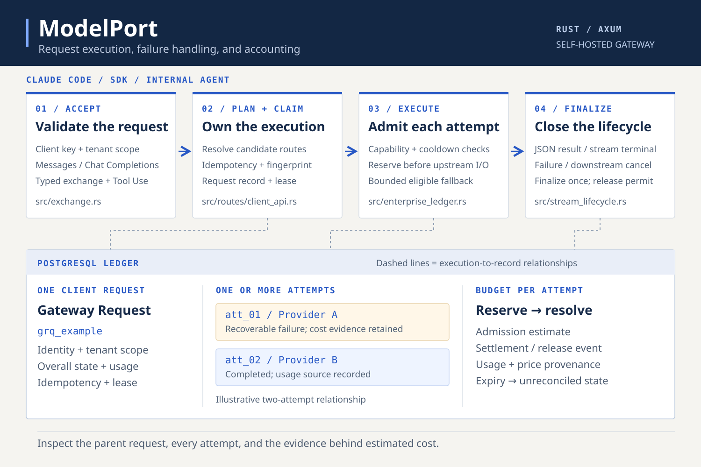

# Request Lifecycle And Evidence

ModelPort keeps three related objects separate: a client **request**, each
upstream **attempt**, and each attempt's **budget reservation**. This guide
connects that model to the current implementation and representative tests.

## 1. Accept And Validate

The client API authenticates the caller, parses the selected client protocol,
and creates a typed exchange. The exchange carries supported text, tool
definitions, tool calls/results, usage, and termination semantics. Unsupported
fields are rejected at ingress; candidate-specific capability checks happen
before that candidate is sent upstream.

- Implementation: [exchange](../src/exchange.rs),
  [client API](../src/routes/client_api.rs), [adapters](../src/providers/).
- Representative tests in [routes.rs](../src/routes.rs):
  `converts_openai_chat_request_and_anthropic_response_across_protocols`,
  `rejects_unsupported_openai_chat_fields_instead_of_dropping_them`, and
  `deduplicates_cumulative_stream_tool_arguments`.

Tool execution belongs to the client Agent. The gateway translates and passes
the supported tool protocol; it does not run the client's tools.

## 2. Build Candidates And Claim The Request

Model resolution produces a candidate plan. An explicit Provider selection
retains that intent. Fallback remains bounded by the plan and by permission,
protocol capability, credential health, quota, and budget admission.

A caller-supplied idempotency key is hashed within the tenant scope. A request
fingerprint checks that a reused key corresponds to the same parsed request and
client protocol. PostgreSQL uniqueness arbitrates competing keyed inserts;
execution leases constrain subsequent owner-sensitive updates. In the current
API, duplicate keyed requests return HTTP 409, including completed requests.

- Implementation: [client API](../src/routes/client_api.rs),
  [ledger](../src/enterprise_ledger.rs),
  [uniqueness and lease migration](../migrations/0002_idempotency_and_leases.sql).
- Representative test in [routes.rs](../src/routes.rs):
  `concurrent_idempotency_claim_allows_exactly_one_request`.

Lease ownership protects ledger writes. Expiry reconciliation closes abandoned
records; it cannot undo an HTTP request already sent to a Provider.

## 3. Admit Each Attempt And Call Upstream

An admitted candidate receives its own attempt and budget reservation in a short
transaction. The network call runs after the transaction. Normal settlement
uses returned usage when available, otherwise a local estimate, retaining its
provenance. Recoverable failures may advance to another eligible candidate,
which needs a new admission and reservation.

For example, a first Provider can fail after a request was sent and a second
Provider can complete the request. The parent request records the overall
result while both attempts remain inspectable. A failed sent attempt can still
have an estimated cost; a timeout does not establish that the Provider charged
nothing. Candidate retries stop once a stream is being delivered to the client.

- Implementation: [client API](../src/routes/client_api.rs),
  [ledger transactions](../src/enterprise_ledger.rs),
  [Provider cooldown](../src/provider_status.rs).
- Representative test in [routes.rs](../src/routes.rs):
  `fallback_accounts_every_sent_provider_attempt`.
- Representative tests in [enterprise_ledger.rs](../src/enterprise_ledger.rs):
  `memory_budget_allows_only_one_competing_reservation_within_hard_limit` and
  `memory_budget_settlement_is_exact_and_idempotent`.

Reservations provide estimated admission control. Current amounts are rounded
USD micro-units; actual charges remain subject to Provider billing. Expired
abandoned records are marked unreconciled and their reservations released, so
operators must distinguish that state from confirmed zero upstream cost.

## 4. Finalize The Response Lifecycle

For streaming, HTTP headers are only the start of delivery. The lifecycle tracks
upstream completion or failure, observed usage, and downstream cancellation.
EOF without the required protocol terminal signal is an upstream failure.

`StreamFinalizationGuard` holds an optional context. Normal completion takes
that context; the drop path takes it only if still present. Tracked asynchronous
finalizers settle the attempt and parent request and release execution
maintenance. The stream concurrency permit stays with the response body.
Process crashes use the separate database reconciliation path.

- Implementation: [stream lifecycle](../src/stream_lifecycle.rs),
  [guard and response body](../src/routes/client_api.rs),
  [tracked finalizers](../src/finalization.rs).
- Representative tests in [routes.rs](../src/routes.rs):
  `stream_protocol_failure_is_reconciled_after_successful_handshake`,
  `dropping_stream_response_records_downstream_cancellation_once`, and
  `openai_chat_stream_preserves_usage_chunk_and_reconciles_actual_usage`.

## Evidence Scope

The named tests are existing source examples, not a report of a new test run.
The route tests cited here use controlled local upstreams and the test-only
memory ledger. The `memory_budget_*` tests exercise memory-ledger behavior;
PostgreSQL concurrency guarantees must also be assessed from the SQL conditions,
schema constraints, and database-backed checks. Test presence alone does not
establish a passing database integration run.

The [dashboard screenshots](assets/README.md) render the actual React interface
with synthetic API fixtures. They demonstrate how to inspect the records, not
backend execution, real Provider compatibility, or measured performance.

For broader contracts, see [Architecture](ARCHITECTURE.md),
[API](API.md), [Operations](OPERATIONS.md), and
[the relational-state ADR](adr/0003-relational-state-and-transactions.md).
